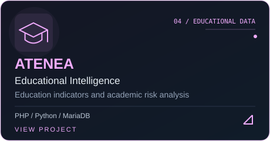
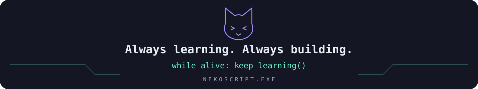

# Hi there, I'm Ian Azael!

**Data & AI Engineering Student | Developer | Technology Enthusiast**

---

## About me

I'm a Data and Artificial Intelligence Engineering student at the
Universidad Politécnica de Querétaro, Mexico.

I'm passionate about technology, software development, data engineering,
machine learning and building solutions to real-world problems.

I enjoy exploring new technologies, experimenting with Linux,
and turning ambitious ideas into functional projects.

## Technology stack

## Featured projects

## Developer activity

## Contribution snake

<picture>
  <source media="(prefers-color-scheme: dark)" srcset="https://raw.githubusercontent.com/nekoscript-exe/nekoscript-exe/output/snake-dark.svg">
  <source media="(prefers-color-scheme: light)" srcset="https://raw.githubusercontent.com/nekoscript-exe/nekoscript-exe/output/snake.svg">
  
</picture>

---

