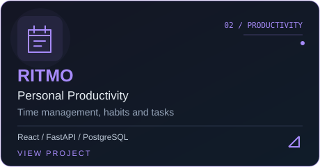
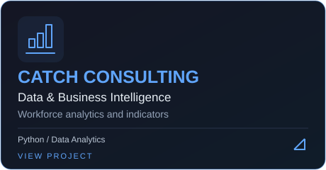
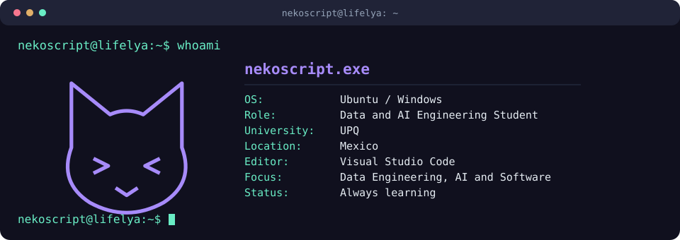
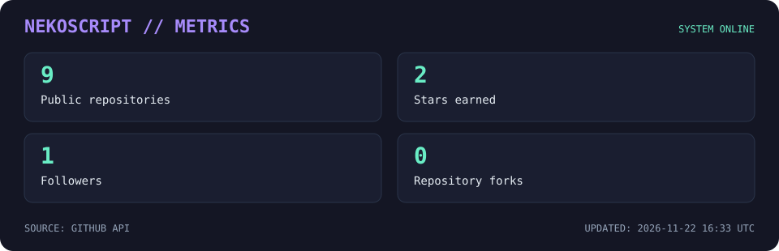
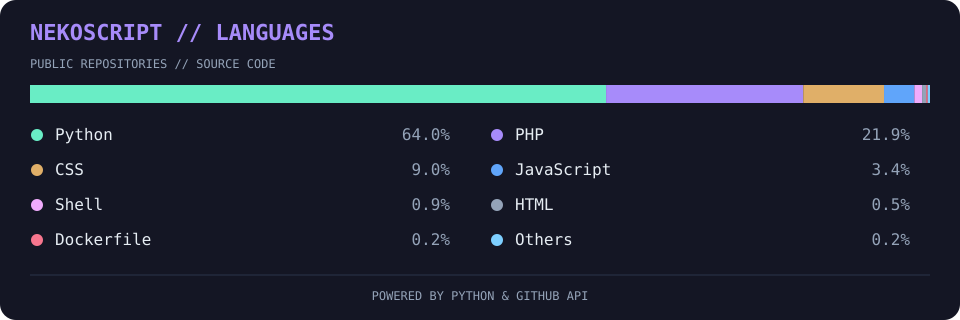

# Hi there, I'm Ian Azael!

**Data & AI Engineering Student | Developer | Technology Enthusiast**

---

## Featured projects

---

## About me

I'm a Data and Artificial Intelligence Engineering student at
Universidad Politécnica de Querétaro, Mexico.

I build software, explore intelligent systems and transform data
into meaningful solutions.

## Technology stack

<h4>Languages</h4>

<h4>Data &amp; Artificial Intelligence</h4>

<h4>Frontend &amp; Backend</h4>

<h4>Database Systems</h4>

<h4>DevOps &amp; Infrastructure</h4>

## Exploring the future

`Artificial Intelligence` · `Data Engineering` · `Scientific Computing`

`Software Architecture` · `Linux & Infrastructure` · `Data Visualization`

*Never stop exploring.*

## Developer activity

## Contribution snake

<picture>
  <source media="(prefers-color-scheme: dark)" srcset="https://raw.githubusercontent.com/nekoscript-exe/nekoscript-exe/output/snake-dark.svg">
  <source media="(prefers-color-scheme: light)" srcset="https://raw.githubusercontent.com/nekoscript-exe/nekoscript-exe/output/snake.svg">
  
</picture>

---

